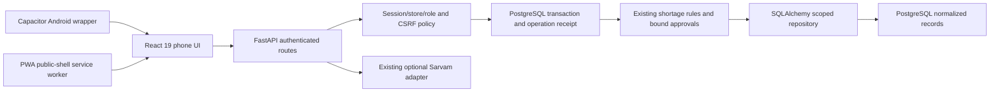

# Current architecture after Batches 2–4

The original supplier-credit workflow remains the product core. New foundation code adds data/security boundaries and a shared installable shell; it does not add inventory, customer ledgers, forecasting or Paytm payment data.

## Files and boundaries

- `backend/models.py`: normalized SQLAlchemy Core metadata; no startup create-all.
- `backend/db.py`: PostgreSQL-only engine selection and schema-specific connection pools.
- `backend/migrations/`: reviewed Alembic DDL, append-only triggers and recovery projection view.
- `backend/auth.py`: scrypt passwords, hashed opaque sessions, verified store membership and role permissions.
- `backend/security.py`: exact origin policy, CSRF, rate limits, store-scoped idempotency locks/receipts and request transaction.
- `backend/store.py`: normalized case reconstruction and scoped persistence. Route handlers retain the original state-machine operations.
- `backend/actions.py`: proposal digest, version, approval invalidation, expiry and execution policy.
- `backend/domain.py`: validated exact quantities, deterministic integer-paise calculation and copied approval snapshots.
- `frontend/src/session.jsx`: account/development sign-in and clearing the workspace on successful logout.
- `frontend/src/pwa.jsx`, `frontend/public/sw.js`, `scripts/build-pwa.cjs`: public-shell install, cache and update lifecycle.
- Existing `CaseDetail`, `InvoiceIntake`, `CaseActions` remain in use; mobile lists replace table layouts without new domain logic.
- `capacitor.config.json`, `android/`: package the same built frontend; no parallel native domain model.

## Trust and transaction model

Session membership supplies store context. Client JSON cannot choose a tenant. Reads/writes use store predicates; related rows carry composite store foreign keys. Owner, staff and viewer are intentionally small roles.

An authenticated unsafe request requires CSRF for cookies (bearer-native sessions are exempt from cookie CSRF), an Idempotency-Key, current permission and normal domain checks. The request owns a PostgreSQL transaction. An advisory transaction lock serializes a store/key; business state and accepted response commit together. Errors roll back the whole operation.

Approvals bind a proposal version and canonical payload digest; changed proposals lose approval. Source versions and payloads are checked again at execution. The existing direct merchant approval endpoint invokes the central primitive. Ledger exports require approved execution rather than an unauthenticated GET.

Audit, resolution and financial-event rows reject updates/deletes. Current balances are derivable from immutable events; `case_recovery_balances` is a read-only view. Historical approval snapshots remain JSONB to preserve the original reviewed evidence. Runtime DB privileges must not allow trigger bypass. No inventory table has been added prematurely.

## Offline and native boundaries

Service-worker cache contains only the shell, manifest/icons and build assets. All API requests remain network-only. Private device drafts and a minimal unapproved receiving cache live in scoped IndexedDB stores. Tokens are not persisted there. A durable outbox synchronizes only the approved Batch 4 draft operation types; server approval/recovery stay online-only. App update activation is user-controlled and warns about unsaved input.

PWA cookie sessions are HttpOnly/Secure in production. The native adapter can request the same opaque session as an in-memory bearer after actual password/development-code authentication. Native API access requires an explicitly configured HTTPS base and allowed origin. Native process restart requires login; durable native credential storage has not been introduced.

The PWA and APK share source and behavior. The native shell does not need the web service worker to start offline. Download/share/camera permissions and device behavior require actual device testing; no speculative permissions are declared.

## Remaining operational work

Ingress body/rate limits, multi-worker rate-limit coordination, file decoding/malware scanning, retention jobs, recovery operations and deployment configuration need production-specific review. Provider quality and device behavior are not established by mocked/API or headless-browser tests. Do not expose a development login or use superuser DB credentials in a deployed merchant environment.

## Batch 4 boundary

`frontend/src/offline/db.js` owns IndexedDB schema/transactions and frozen outbox state. `sync.js` owns bounded, dependency-aware transport and receipt validation; `provider.jsx` handles foreground/online lifecycle. `Workspace.jsx` is the phone draft/conflict surface. SessionGate activates/clears verified user/store/role context and supports a limited offline workspace grant.

`backend/sync.py` is an allowlist adapter into existing supplier persistence, not a new merchant service or ledger. It reuses PostgreSQL idempotency receipts, scoped repositories, expected case versions and append-only audits. It accepts no tenant IDs or offline approval/recovery commands. No server schema migration is needed in Batch 4. Read SYNC-PROTOCOL.md for the complete wire/state/storage contract.
