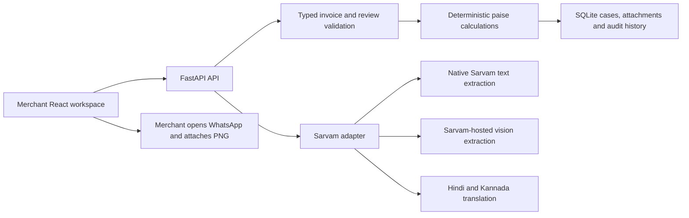
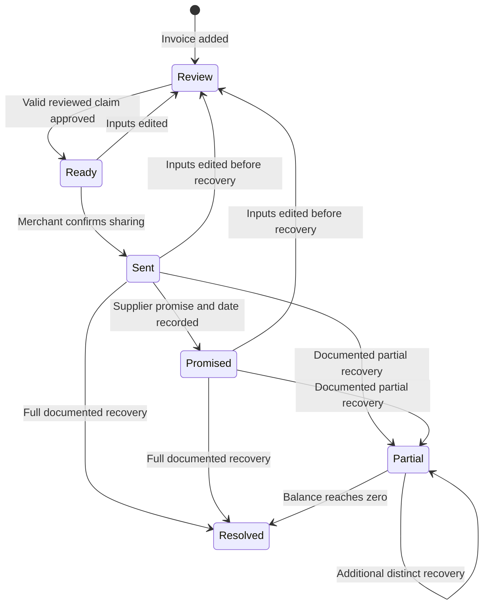

# Architecture and implementation decisions

## Product boundary

Munafa focuses on invoice shortages and documented supplier-credit follow-up. This implements the source deck's explicit merchant confirmation and approval gates. It does not claim to be a general ERP, lender or autonomous collections agent.

The key refinement is a complete case lifecycle with explicit recovery accounting. A promise, a generated message or a credit-note upload cannot independently close a case.

## Components

- **React 19 + Vite**: responsive workspace with dashboard, case detail, supplier ledger and insights. Browser state refreshes from authoritative API responses after every mutation.
- **FastAPI + Pydantic**: typed request contracts, field limits, restricted units, validation and generated OpenAPI docs.
- **SQLite**: zero-service local setup. JSON case records retain structured invoice/review/audit data. Attachments are stored as database blobs, not public static files. Transactions serialize changes and versions reject stale tabs.
- **Sarvam HTTP adapter**: server-side credentials, bounded requests, validation and explicit failure handling. No privileged tools or state mutation are exposed to the models.

SQLite replaces the deck's planned PostgreSQL for the first local build. PostgreSQL with normalized tables and store-scoped queries is a deployment prerequisite; this JSON-backed prototype is not a demonstrated architecture for millions of merchants.

## Case lifecycle

Editing any review input invalidates current approval, amount and follow-up. Earlier sharing history remains. Each new approval stores an immutable invoice/count/price/amount snapshot in the audit history. Once any recovery has been recorded, invoice edits are blocked so historical recovery cannot become detached from its original claim.

A draft with no shortage cannot be approved as a credit claim. It remains a reviewed invoice; a separate “matched/no-claim” archive state is future work.

## Money and receiving rules

For each eligible line:

`shortage_paise = (billed_whole_units − received_whole_units) × effective_unit_price_paise`

- All monetary persistence and calculations use integer paise.
- Whole units only in this version, including whole kg. Fractional quantities require an expanded quantity model.
- Merchant must confirm the same billed and received unit. `unknown`, carton/pack mismatches or an unchecked unit confirmation block the entire claim.
- Unknown receiving counts, counts exceeding billed quantity, incomplete delivery and unverified effective prices block approval.
- The merchant corrects net unit prices after considering tax, discounts and schemes. The app does not perform GST or scheme calculations.
- UI estimates never override the backend; approval re-runs all calculation gates.

## Resolution rules

Every recovery requires:

1. An approved and merchant-confirmed shared case.
2. Supplier and original invoice reference matching after case/whitespace normalization.
3. A positive integer-paise amount no greater than the remaining balance.
4. A proof attachment belonging to that case.
5. A unique supplier credit-note/refund reference.
6. A proof-content SHA-256 digest not previously recorded for that supplier.
7. Merchant attestation that the credit was applied or refund received.

The reference and digest inserts occur in the same transaction as the case update. Failed validation rolls them back. Partial recovery stays open. A zero balance resolves the case and clears its follow-up date.

This is **merchant-assisted verification**. File presence, identifiers and arithmetic are checked; the authenticity and business meaning of the uploaded document are not independently verified. Multi-invoice application of a single credit note is intentionally unsupported and blocked by the uniqueness rule.

## API surface

All routes begin with `/api`. Interactive schema is at `/docs`.

| Method and path                       | Purpose                                                          |
| ------------------------------------- | ---------------------------------------------------------------- |
| `GET /health`                         | Local mode and Sarvam configuration presence, never key contents |
| `GET /cases`, `GET /cases/{id}`       | Read cases with derived amounts/issues                           |
| `POST /invoices/sample`               | Create the A-104 synthetic invoice once                          |
| `POST /invoices/manual`               | Create typed merchant invoice                                    |
| `POST /invoices/extract-text`         | Structure pasted invoice with native Sarvam model                |
| `POST /invoices/extract`              | Read image using Sarvam-hosted vision                            |
| `PATCH /cases/{id}/review`            | Save receiving evidence and corrected invoice fields             |
| `POST /cases/{id}/approve`            | Validate and snapshot merchant approval                          |
| `POST /cases/{id}/message`            | Prepare deterministic English or Sarvam translation draft        |
| `POST /cases/{id}/sent`               | Explicit merchant sharing confirmation                           |
| `POST /cases/{id}/promise`            | Record promise and follow-up date                                |
| `POST /cases/{id}/proof`              | Attach credit/refund image or PDF                                |
| `POST /cases/{id}/sample-proof`       | Synthetic next-bill fixture for synthetic cases only             |
| `POST /cases/{id}/resolve`            | Verify and record partial/full credit or refund                  |
| `GET /cases/{id}/approvals/{version}` | Inspect an earlier approved snapshot                             |
| `GET /attachments/{id}`               | Read stored evidence                                             |
| `GET /export`                         | Export ledger CSV with formula-injection protection              |

Mutating case operations carry the current `version`. Successful mutations increment it; stale requests return `409` and require reloading. Unknown IDs return `404`, malformed contracts `422`, and rule/provider failures `409`. Invoice identity is unique per normalized supplier/reference; duplicate imports point the merchant to the existing case.

## Data and privacy

The server is bound to `127.0.0.1`. There is no login or store isolation, so all local users with API access share the same workspace. Browser writes from foreign origins are blocked. File size is capped at 8 MB, allowed types/signatures are checked, file IDs are server-generated, and responses use `nosniff` and no-store caching for API data. These are prototype controls, not production security guarantees. Image decoding, malware scanning, content sandboxing, total request limits, encryption and retention policies remain deployment work.

AI calls occur only through explicit extraction/translation actions. Invoice text/image or the approved message goes to Sarvam, so obtain merchant consent before using real records. No external Paytm calls occur. WhatsApp is a user-opened link; the merchant chooses the recipient and sends. Browser voice input is optional and may use vendor services.

## Validation boundary

Domain/API tests exercise workflow and accounting rules. Mocked provider contracts verify endpoint, headers, model selection, image payloads, translations and error paths. Browser tests exercise approval, PNG download, promise, full closure, persistence, navigation and mobile manual intake. They do not establish live Sarvam accuracy, real supplier acceptance, authentication strength or measured business impact.
