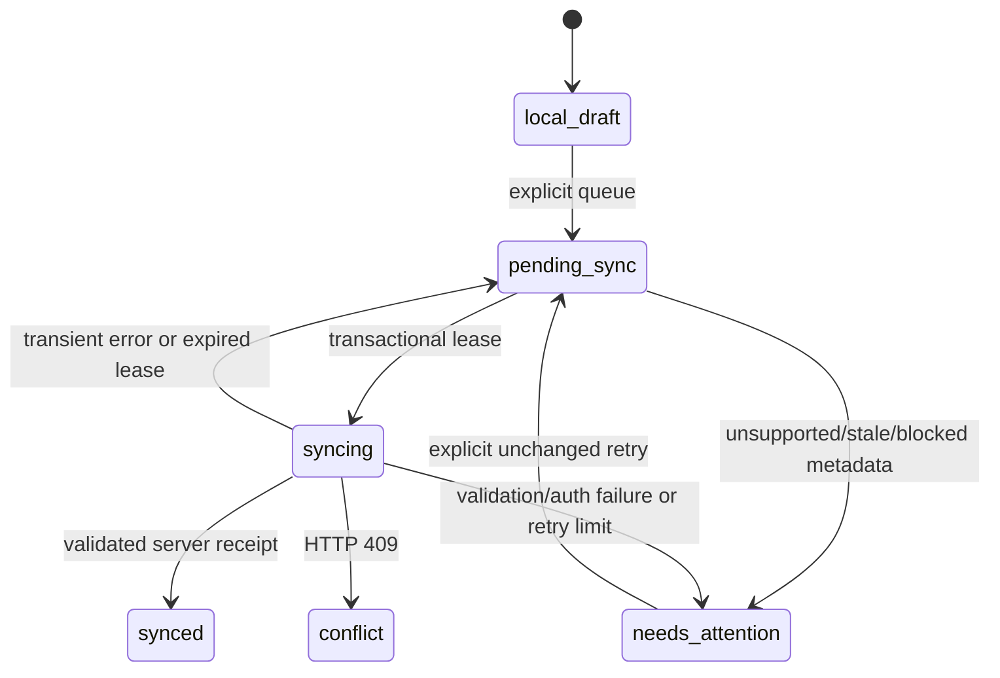

# Offline draft and sync protocol · version 1

Batch 4 adds device storage and draft transport to the existing supplier workflow. PostgreSQL remains the only server application database. The service worker still caches only public assets; IndexedDB owns private device data. No SQLite, local SQL wrapper, offline financial approval or stock ledger is introduced.

## Scope and trust

A previously verified identity may reopen its device workspace for eight hours after verification. This is an offline convenience grant, **not authentication**. No password, bearer token, session cookie value or CSRF token is written to IndexedDB. Native bearer tokens remain memory-only. Cookie sessions remain server-controlled.

The context key is a canonical tuple of verified user ID, store ID, role and sorted permissions. Every repository transaction checks that the active context matches its scope. Account/store/role changes clear the previous private stores. BroadcastChannel notifies other tabs, which stop using the old workspace; correctness also relies on transactional scope checks and server authorization, not channel delivery.

Every sync batch calls `/api/auth/me` and checks the identity/membership against the saved scope. The server derives the tenant from the verified session. The request envelope contains **no tenant ID**. Cross-store entity IDs return 404. Staff may sync allowlisted drafts; viewers cannot write. Approvals, recovery, exports and messaging retain their existing separate permission/approval rules and are not eligible outbox operations.

An expired session pauses sync and preserves drafts for same-account sign-in. A verified membership change clears the former context. Explicit sign-out warns before removing private device drafts, blobs and receipts, stops/aborts client sync, and revokes the server session when connected. Offline sign-out sets a non-private revocation-pending marker so a later reload does not silently restore the cookie session; server revocation still needs connectivity. An already accepted/in-flight server operation cannot be undone by clearing a device.

## IndexedDB schema

Database: `munafa-offline`, version **1**. All private stores use globally unique `id` keys plus a `scope` index.

| Store         | Stored fields                                                                                                                                                                    | Retention                                                                                                                                                  |
| ------------- | -------------------------------------------------------------------------------------------------------------------------------------------------------------------------------- | ---------------------------------------------------------------------------------------------------------------------------------------------------------- |
| `meta`        | Whitelisted verified identity, scope, offline grant expiry; logout-pending boolean                                                                                               | Grant refreshed only after verified connectivity; cleared on sign-out/context change                                                                       |
| `cache`       | Up to 50 unapproved case IDs/versions/statuses and receiving source fields: supplier/reference/date, item names, billed/received quantities/units, unit prices and confirmations | 24 hours; no supplier phone, audit history, recovery, settlements or private documents                                                                     |
| `drafts`      | `kind` (`invoice` or `receiving`), local ID, scope, payload/schema version, source version, device timestamps, state, server receipt                                             | Unsynced/failed/conflicted drafts retained until explicit discard or sign-out; terminal copies removed after 7 days from acceptance                        |
| `attachments` | Draft ID, Blob, filename/MIME, SHA-256, scope and device timestamp                                                                                                               | Up to 4 MB per file / 40 MB of raw blobs per context; removed only after the complete draft including attachment is accepted, or explicit discard/sign-out |
| `outbox`      | Operation envelope, draft ID, frozen wire request, state/transition log, attempt count, next retry, lease owner/expiry, minimal receipt/error                                    | Same lifecycle as the owning draft; never delete merely because a request failed                                                                           |
| `status`      | Last server-acknowledged sync time for context                                                                                                                                   | Cleared on context change/sign-out                                                                                                                         |

The polymorphic draft shape reserves a future inventory-operation kind, but **no inventory operation is currently eligible** because no server stock ledger exists. Repository saves reject unsupported kinds and the server allowlist rejects stock, financial and message mutations. There are no pretend stock availability values or stock buttons.

Draft edits commit only when the merchant chooses **Save on this device**. Unsaved form input remains in memory and is labelled accordingly. Incomplete local entry is allowed; server submission still validates the complete invoice. Queuing is a separate explicit merchant action and freezes the proposal. Queue creation, draft state and dependent attachment operation are one IndexedDB transaction. State notifications follow transaction completion, never only request success.

### State machine



All transitions are persisted; the last 30 transitions are retained per operation. Editable conflicts create a **new local draft and new operation ID** after displaying current server counts/version. There is no automatic merge, blind overwrite or transition from conflict directly to synced. The old proposal remains visible until explicitly discarded. Approved/resolved cases cannot receive offline count changes.

The repo prevents edits to queued operation identity/payload and prevents replacement of an existing frozen wire request. A draft’s display state aggregates its dependent operations; an invoice with an unsynced attachment remains provisional.

## HTTP operation envelope

`POST /api/sync/operations`, authenticated, CSRF-bound for cookie sessions. `Idempotency-Key` must equal the UUID `operation_id`.

```json
{
  "operation_id": "550e8400-e29b-41d4-a716-446655440000",
  "operation_type": "invoice_create",
  "payload_schema_version": 1,
  "entity_id": null,
  "expected_version": null,
  "client_created_at": "2026-10-30T08:30:00Z",
  "dependency_ids": [],
  "payload": { "invoice": "existing validated Invoice object" }
}
```

The example's `invoice` description is schematic; real requests contain the existing structured Invoice model. Server timestamps, not client timestamps, determine acceptance/audit time. Client time is transport metadata, never ledger truth.

| Type                | Payload / preconditions                                                                                                                     | Server effect                                                                                                                                                       |
| ------------------- | ------------------------------------------------------------------------------------------------------------------------------------------- | ------------------------------------------------------------------------------------------------------------------------------------------------------------------- |
| `invoice_create`    | `{invoice: Invoice}`; no target entity/version                                                                                              | Existing manual invoice capture; merchant-entered received values remain unapproved and delivery/pricing approval is not inferred                                   |
| `receiving_save`    | Ordered `{received, received_unit, unit_confirmed}` lines, delivery/pricing confirmations and optional note; target case + expected version | Only an unapproved review case; validates exact quantities, item count and source version; appends audit/version, never a recovery/stock/financial event            |
| `attachment_upload` | Filename/MIME, SHA-256 and base64 bytes; target case + expected version; prerequisite invoice receipt for a newly captured invoice          | Validates complete bytes, signature, size and digest; appends original-bill reference only if absent; increments case version; no OCR or inferred received quantity |

Invoice notes use the existing reviewed invoice `pricing_note` field. Offline receiving only changes merchant receiving fields and this note; it cannot change supplier identity, invoice reference, billed quantities, unit prices or an existing approval. Unknown/mismatched units continue to block later approval.

A successful receipt contains `operation_id`, `entity_id`, `entity_version`, optional `attachment_id` and `accepted_at`. It is intentionally minimal. Each accepted sync operation also creates a scoped append-only audit record linking case ID, operation ID and dependencies; existing case audits remain unchanged in meaning.

### Exactly-once effect, repeatable delivery

The existing PostgreSQL `idempotency_operations` unique store/key constraint and transaction advisory lock serialize a key. Business changes, audit and the accepted response commit in one request transaction. Same actor/key/method/path/body returns the original response with `Idempotency-Replayed: true`; different content/actor conflicts. Authorization is checked before replay. Failed requests roll back and do not record acceptance.

The client persists the complete exact request before sending it. After a timeout or lost reply it retries that request and ID, even if the server version has since increased from that very operation. A stale **new** operation receives 409. No timeout is presented as proof that the server did not accept the request.

Attachments depend on invoice creation. The client derives target ID and initial version from its accepted parent receipt and freezes these before the first attempt. Every declared dependency must have an accepted receipt for the same actor/store. Uploads are bounded whole-file requests, **not resumable chunks**: incomplete JSON/base64/digests fail atomically; retries send the same bytes and ID. No partial accepted attachment is created.

## Scheduling and errors

- At most **3 operations** per batch, in dependency order. Waiting children are never sent first.
- A transactionally acquired **45-second lease** prevents two tabs claiming the same operation. Expired leases recover using the same ID. A resumed old tab cannot complete/fail a lease that another tab has since claimed. Server idempotency remains the final duplicate guard.
- Requests have a **12-second sync timeout**, including response reading. A connection failure/lost reply returns the operation to pending with exponential backoff: `min(60s, 1s × 2^(attempt-1)) × jitter[0.75,1.25]`.
- At most **5 automatic attempts**. Further attempts require explicit review/retry. Proposals older than 30 days pause for review rather than being silently deleted.
- Resume on online/foreground events and a 15-second foreground scheduler. No Background Sync dependency or promise is made; browser suspension can delay sync until the app opens again.
- 401 requires reauthentication; 403 requires permission/membership attention. 400/404/413/422 preserve the draft as needs-attention. 409 requires human conflict review. Transient errors retry within the bound.
- Missing prerequisites and unsupported/corrupted transport metadata pause without deleting the draft. Future IndexedDB versions cause a visible update-required error; old code never resets newer data. A blocked upgrade asks for other tabs to close.
- Quota failures abort the transaction and keep the previous committed draft plus the current open form. Explicit JSON backup is available for open/saved draft fields; **it does not back up attachment bytes**. Keep original documents separately. No automatic backup or silent storage clearing exists.

The development Vite build exposes counts, state, attempts and operation IDs under Sync diagnostics. Production builds do not expose that control. No debug endpoint returns document contents.

## Storage threat model

IndexedDB is same-origin browser/WebView storage. This app has **not implemented or reviewed device-level encryption at rest**. Same-origin scripts, XSS, browser/devtools access and another person using an unlocked shared device may expose it. Sign-out performs logical private-store deletion, not forensic secure erasure. Original documents and intentionally downloaded backups may remain outside the app and are the merchant’s responsibility.

Browser quota/eviction/user-clearing can remove the entire origin, including pending drafts. `navigator.storage.persist()` is an explicit best-effort request, not a guarantee or backup. Complete eviction cannot be reconstructed from an erased local marker; the UI explains the risk and online server-accepted records remain authoritative. See [MDN storage quotas/eviction](https://developer.mozilla.org/en-US/docs/Web/API/Storage_API/Storage_quotas_and_eviction_criteria) and [IndexedDB transaction behavior](https://developer.mozilla.org/en-US/docs/Web/API/IDBTransaction).

A native WebView and a browser installation use their own origin storage; no cross-install/device synchronization of unsynced drafts is claimed. App uninstall/site clearing may lose unsynced records. Physical-device encryption, installation migrations, storage pressure and Android process-kill behavior remain unverified.

## Batch 5 commerce extensions

The same scoped immutable outbox now supports `purchase_create`, dependent `purchase_document_upload`, `purchase_receiving_capture` and explicitly reviewed `inventory_movement`. A document upload waits for the purchase receipt and binds its returned entity/version. The declared checksum must match the original attachment. A purchase with an expected missing document cannot be accepted.

Purchase and receiving sync create drafts only. Receiving acceptance remains online and adds undamaged goods. A queued stock movement requires explicit merchant confirmation, server approval permission and the exact reviewed stock version; only the accepted server event changes confirmed stock. Offline quantities stay decimal strings and monetary values integer paise. Stock version zero is valid. Conflicts retain the original operation; reviewing the latest source creates a new editable copy for an explicit new submission.

## Optional original manual text (31 October 2026)

The v1 purchase_create payload may include source_text, 1–18,000 characters, alongside draft and optional document metadata. It is untrusted original bill text, preserved as a private text source attachment; it does not trigger OCR, approve a purchase, or change receiving/stock. Old payloads remain valid. Normal operation IDs, tenant context, request digest, dependencies and expected-version rules still apply.
